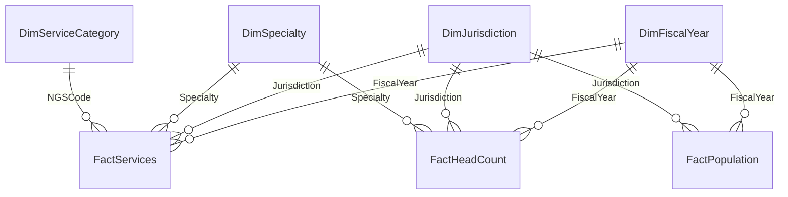

# Data model

Star schema with three fact tables at different grains and four shared dimensions.

| Table | Grain | Key columns |
| --- | --- | --- |
| FactServices | Fiscal year × jurisdiction × specialty × NGS category | Services, Payments, DataStatus |
| FactHeadCount | Fiscal year × jurisdiction × specialty | HeadCount |
| FactPopulation | Fiscal year × jurisdiction | Population |
| DimFiscalYear | Fiscal year | FiscalYear, StartYear |
| DimJurisdiction | Province/territory | Jurisdiction |
| DimSpecialty | Specialty | Specialty, Specialty sort, SpecialtyGroup, IsSubspecialty |
| DimServiceCategory | NGS code | NGSCode, NGSCategory, ServiceCategory |

All relationships are one-to-many with single-direction filtering from dimension to fact. FactPopulation is not related to specialty or service category, so per-capita rates always use the full population of the selected jurisdictions and years.
